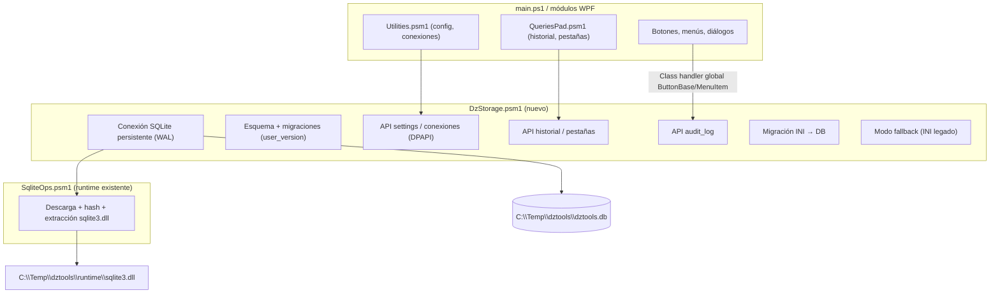
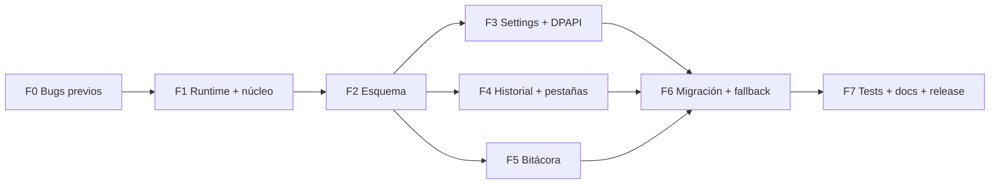

# Plan: Reemplazo de INIs por SQLite (`dztools.db`)

> Estado: **Implementado (pendiente verificación UI interactiva en vivo)**
> Fecha: 2026-11-19
> Alcance: `C:\Temp\dztools\dztools.ini` y `C:\Temp\dztools\Queries.ini` → `C:\Temp\dztools\dztools.db`, más una nueva bitácora de auditoría.

---

## 1. Decisiones tomadas

| # | Tema | Decisión |
|---|------|----------|
| 1 | `sqlite3.dll` | Se sigue **descargando desde GitHub** (no entra al release). Se mueve de `C:\Temp\dztools\release\resources` a **`C:\Temp\dztools\runtime\`** para que no se borre al actualizar (hoy `dztools.ps1` elimina `release\` completo). |
| 2 | Contraseñas SQL | **Cifradas con Windows DPAPI** (`CurrentUser` + entropía por servidor), con columna de formato versionado para poder rotar el esquema de cifrado en el futuro. |
| 3 | Bitácora | Tabla `audit_log` con **captura global de clics** + eventos enriquecidos en acciones sensibles. Pestaña de **consulta (solo lectura)** con filtros por columnas visible únicamente cuando **DEBUG** está activo (`tabBitacora`). Con filtro anti-ruido (Cerrar, Cancelar, ×, navegación, controles del visor, etc.). |
| 4 | Historial de queries | **Sin límite de 100**, todo filtrado/paginado/búsqueda **en SQL**, con `duration_ms`, filtros (servidor/BD/estado/fechas) y **Favoritos**. |

### Fuera de alcance (no se tocan)

- INIs externos de NationalSoft (`restaurant.ini`, `DbConfig.ini`, `nshoteles.ini`, `checadorsql.ini`, `RestCard.ini`).
- API key de Gemini y token de R2: siguen **solo en memoria**.
- Respaldos NVMe (`.reg`/`.json` en `C:\Temp\dztools\backups\nvme`) — solo se auditan sus acciones.
- Base `C:\NationalSoft\nspfmsync.db` del limpiador SQLite (sigue en `SqliteOps.psm1`).

---

## 2. Arquitectura objetivo



### Estructura de carpetas en el equipo cliente

```text
C:\Temp\dztools\
├── release\                 <- se borra/reemplaza en cada actualización
├── runtime\
│   ├── sqlite3.dll          <- descargado, persistente
│   ├── sqlite3.dll.sha256   <- hash registrado tras la extracción
│   └── sqlite-dll-win-x64-3530200.zip (caché)
├── dztools.db               <- NUEVO (+ dztools.db-wal / -shm)
├── backups\
│   ├── db\                  <- respaldos rotativos de dztools.db (VACUUM INTO)
│   └── nvme\                <- sin cambios
├── dztools.ini.migrated.bak <- respaldo post-migración (contraseñas redactadas)
├── Queries.ini.migrated.bak
└── audit-pending.jsonl      <- solo si SQLite no estuvo disponible (fallback)
```

### Módulos

| Módulo | Cambio |
|--------|--------|
| `src/modules/DzStorage.psm1` | **Nuevo.** Wrapper de conexión, esquema, migraciones, settings, conexiones SQL cifradas, historial, pestañas, auditoría, migración de INIs y fallback. |
| `src/modules/SqliteOps.psm1` | Se conserva el runtime (descarga/hash/extracción) y el limpiador de `nspfmsync.db`. Solo cambia la ruta del runtime y se agrega hash del DLL. |
| `src/modules/Utilities.psm1` | Las funciones públicas de config conservan firma, pero delegan a `DzStorage`. |
| `src/modules/QueriesPad.psm1` | Historial y pestañas delegan a `DzStorage`; se rediseña `Show-QueryHistoryWindow`. |
| `src/modules/GUI.psm1` | Marca ventanas de sistema (`MessageBox`, progreso) como no auditables. |
| `src/main.ps1` / `build.ps1` | Registrar `DzStorage.psm1` en `$modules` (lo exige `tests/Basic.Tests.ps1`). Inicialización de storage y auditoría. |

**Orden de carga propuesto** en `$modules` (main.ps1 y build.ps1):
`GUI, Database, Utilities, SqliteOps, DzStorage, CloudBackup, SqlTreeView, ...`
(`DzStorage` depende de `SqliteOps` para el runtime; nadie llama al storage en tiempo de importación, solo en `Initialize-Environment`).

---

## 3. Fase 0 — Correcciones previas (bajo riesgo, independientes)

Se hacen primero porque afectan directamente a la nueva capa:

1. **Doble importación de módulos** — [main.ps1](src/main.ps1) importa los 14 módulos con `-Force` al inicio y otra vez dentro de `Start-Application` (líneas ~984-989), lo que reinicia todas las variables `$script:` (y reiniciaría la conexión SQLite persistente). → Eliminar el segundo bucle de importación.
2. **Comparación rota** — [Database.psm1](src/modules/Database.psm1) `$connections -contains ".\\NationalSoft"` nunca coincide. → `".\NationalSoft"`.
3. **Variable equivocada** — `Stop-ExecutionTimer` en main.ps1 usa `$global:lblExecutionTime` en vez de `$global:lblExecutionTimer`.
4. **Exportaciones duplicadas** — `Apply-SavedSqlCredentials` (Utilities), `Show-QueryHistoryWindow` (QueriesPad), `Remove-SqlComments` (Database).

---

## 4. Fase 1 — Runtime SQLite persistente y núcleo de conexión

### 4.1 Runtime (`SqliteOps.psm1`)

- `$script:DzSqliteResourceDir` → `C:\Temp\dztools\runtime`.
- **Auto-migración del DLL:** si no existe en `runtime\` pero sí en `release\resources\` (instalaciones actuales), se copia tras validar.
- Tras extraer el ZIP (cuyo SHA256 ya se valida), se calcula y guarda el SHA256 del DLL en `sqlite3.dll.sha256`. En cada arranque se verifica antes de cargarlo; si no coincide → se borra y se vuelve a extraer/descargar.
- **Carga unificada sin colisiones:** precargar el DLL mediante `LoadLibrary` con ruta absoluta (en lugar de depender únicamente de `SetDllDirectory`) para asegurar que tanto `DzTools.Sqlite.NativeClient` (`SqliteOps.psm1` / backup SQLite en runspace de `SqlOps.psm1`) como `DzTools.Storage.SqliteDb` compartan la misma instancia verificada de `sqlite3.dll`.
- Se mantiene la restricción x64 (mensaje claro si se ejecuta en PowerShell x86 → modo fallback).
- Se agrega `Test-DzSqliteRuntimeAvailable` (sin descarga) para decidir el modo de arranque rápido.
- `dztools.ps1` **no requiere cambios**: solo limpia `C:\temp\dztools\release`, dejando intactos `runtime\` y `dztools.db`.

### 4.2 Wrapper de conexión (`DzStorage.psm1`, C# vía `Add-Type`)

El `NativeClient` actual no sirve como BD interna (no crea archivos, solo bindea `string`, abre/cierra en cada llamada, sin transacciones). Se crea una clase nueva **`DzTools.Storage.SqliteDb`** (namespace distinto para no chocar con el cliente del limpiador):

| Capacidad | Detalle |
|-----------|---------|
| Apertura | `SQLITE_OPEN_READWRITE \| SQLITE_OPEN_CREATE \| SQLITE_OPEN_FULLMUTEX`, ruta UTF-8. |
| Conexión persistente | Una conexión por sesión en el hilo UI (`Open()` en arranque, `Close()` en `Window.Closing`). |
| PRAGMAs al abrir | `journal_mode=WAL`, `synchronous=NORMAL`, `foreign_keys=ON`, `busy_timeout=5000`, `temp_store=MEMORY`. |
| Binding tipado | `object[]`: `null/DBNull` → `bind_null`, `int/long/bool` → `bind_int64`, `double/decimal` → `bind_double`, `byte[]` → `bind_blob`, resto → `bind_text`. Soporte de parámetros con nombre (`@name`) vía `sqlite3_bind_parameter_index`. |
| API | `Execute(sql, params)` → filas afectadas; `Query(sql, params)` → `QueryResult`; `Scalar(sql, params)`; `LastInsertRowId`; `BeginImmediate/Commit/Rollback`. |
| Caché de sentencias | Cache simple `sql → stmt` (reset + clear_bindings) para inserts frecuentes (auditoría, historial). |
| Errores | Excepción con `sqlite3_extended_errcode` + mensaje. |

Funciones PowerShell expuestas (internas al módulo salvo indicación):

- `Initialize-DzStorage` (exportada) → resuelve runtime, abre DB, aplica migraciones, devuelve `$true` (SQLite) o `$false` (fallback).
- `Close-DzStorage` (exportada).
- `Invoke-DzDbNonQuery`, `Invoke-DzDbQuery`, `Invoke-DzDbScalar`, `Invoke-DzDbTransaction { ... }`.
- `Get-DzStorageMode` (exportada) → `'sqlite' | 'fallback'`.

> [!NOTE]
> Los workers en runspaces (ejecución de queries en QueriesPad, backups en SqlOps) **no** usan la conexión persistente. Ningún worker escribe en `dztools.db` hoy: el historial se guarda en el `DispatcherTimer` del hilo UI. Si en el futuro un worker necesita escribir, abrirá su propia conexión (WAL + `busy_timeout` lo soportan).

---

## 5. Fase 2 — Esquema de base de datos

Versionado con `PRAGMA user_version`. Migraciones idempotentes en `Update-DzStorageSchema`, cada una dentro de una transacción `BEGIN IMMEDIATE`.

Convenciones:
- Fechas en **UTC ISO-8601** (`yyyy-MM-ddTHH:mm:ss.fffZ`) para ordenar correctamente; se convierten a hora local al mostrar.
- Booleanos como `INTEGER 0/1`.
- Texto en UTF-8 directo (adiós Base64 en el SQL del historial).

### v1 — Esquema inicial

```sql
-- Metadatos de la app / migraciones
CREATE TABLE app_meta (
    key         TEXT PRIMARY KEY,
    value       TEXT,
    updated_at  TEXT NOT NULL
);

-- Reemplaza [desarrollo] y [UI] de dztools.ini
CREATE TABLE app_settings (
    section     TEXT NOT NULL COLLATE NOCASE,
    key         TEXT NOT NULL COLLATE NOCASE,
    value       TEXT,
    updated_at  TEXT NOT NULL,
    PRIMARY KEY (section, key)
) WITHOUT ROWID;

-- Reemplaza [sql] de dztools.ini
CREATE TABLE sql_connections (
    id                 INTEGER PRIMARY KEY,
    server             TEXT NOT NULL UNIQUE COLLATE NOCASE,
    username           TEXT NOT NULL,
    password_enc       BLOB,                 -- ciphertext DPAPI
    password_format    TEXT NOT NULL,        -- 'dpapi-cu-v1' | 'none'
    needs_reentry      INTEGER NOT NULL DEFAULT 0,
    last_database      TEXT,
    last_connected_at  TEXT,
    use_count          INTEGER NOT NULL DEFAULT 0,
    created_at         TEXT NOT NULL,
    updated_at         TEXT NOT NULL
);

-- Reemplaza [QueriesHistory] de Queries.ini (sin límite)
CREATE TABLE query_history (
    id              INTEGER PRIMARY KEY,
    executed_at     TEXT NOT NULL,            -- UTC
    server          TEXT,
    database_name   TEXT,
    query_hash      TEXT NOT NULL,            -- SHA-256 del SQL normalizado (16 bytes hex)
    preview         TEXT NOT NULL,
    full_query      TEXT NOT NULL,
    success         INTEGER NOT NULL,
    rows_affected   INTEGER,
    duration_ms     INTEGER,
    result_summary  TEXT,
    error_message   TEXT,                     -- completo (antes truncado a 50)
    is_favorite     INTEGER NOT NULL DEFAULT 0,
    windows_user    TEXT,
    machine_name    TEXT,
    source          TEXT NOT NULL DEFAULT 'app'   -- 'app' | 'ini-migration'
);
CREATE INDEX ix_qh_executed   ON query_history (executed_at DESC, id DESC);
CREATE INDEX ix_qh_server_db  ON query_history (server, database_name, executed_at DESC, id DESC);
CREATE INDEX ix_qh_hash       ON query_history (query_hash, executed_at DESC, id DESC);
CREATE INDEX ix_qh_favorite   ON query_history (is_favorite, executed_at DESC, id DESC) WHERE is_favorite = 1;
CREATE INDEX ix_qh_success    ON query_history (success, executed_at DESC, id DESC);

-- Reemplaza [QueriesOpen] de Queries.ini
CREATE TABLE open_query_tabs (
    tab_index      INTEGER PRIMARY KEY,
    title          TEXT,
    query_text     TEXT NOT NULL,
    is_dirty       INTEGER NOT NULL DEFAULT 0,
    is_active      INTEGER NOT NULL DEFAULT 0,
    file_path      TEXT,
    database_name  TEXT,
    server         TEXT,
    updated_at     TEXT NOT NULL
);

-- Bitácora
CREATE TABLE audit_log (
    id            INTEGER PRIMARY KEY,
    created_at    TEXT NOT NULL,              -- UTC
    session_id    TEXT NOT NULL,              -- GUID por ejecución de la app
    event_type    TEXT NOT NULL,              -- ver catálogo §8.3
    window_title  TEXT,
    control_name  TEXT,
    action_label  TEXT,
    target        TEXT,                       -- ej. servidor/BD, impresora, regla
    details       TEXT,                       -- JSON compacto, sin secretos
    status        TEXT,                       -- 'OK' | 'CANCELLED' | 'ERROR' | 'INFO'
    windows_user  TEXT NOT NULL,
    machine_name  TEXT NOT NULL,
    app_version   TEXT,
    is_admin      INTEGER NOT NULL
);
CREATE INDEX ix_audit_created ON audit_log (created_at DESC);
CREATE INDEX ix_audit_type    ON audit_log (event_type, created_at DESC);
CREATE INDEX ix_audit_session ON audit_log (session_id);
```

### v1 (condicional) — Búsqueda full-text del historial

Se detecta FTS5 en tiempo de ejecución (`PRAGMA compile_options` / intento de `CREATE VIRTUAL TABLE`). El DLL oficial de sqlite.org para Windows normalmente lo incluye; si no, se usa `LIKE` como fallback.

```sql
CREATE VIRTUAL TABLE query_history_fts USING fts5(
    full_query, preview, server, database_name,
    content='query_history', content_rowid='id',
    tokenize='trigram'          -- búsqueda por subcadena (≥ 3 caracteres)
);
-- Triggers AFTER INSERT / AFTER DELETE / AFTER UPDATE para mantenerla sincronizada.
```

Se guarda en `app_meta('fts5_enabled')`. Búsquedas de < 3 caracteres usan `LIKE ... ESCAPE '\'`.

### Settings: mapeo de claves

| INI actual | `app_settings (section, key)` | Default |
|------------|-------------------------------|---------|
| `[desarrollo] debug` | `dev, debug` | `false` |
| `[UI] mode` | `ui, mode` | `light` |
| `[UI] stacked_results` | `ui, stacked_results` | `true` |
| — | `history, page_size` | `200` |
| — | `history, retention_days` | `0` (ilimitado) |
| — | `audit, enabled` | `true` |
| — | `audit, retention_days` | `0` (ilimitado) |
| — | `audit, excluded_controls` | lista por defecto (§8.2) |
| — | `storage, backup_keep` | `5` |

---

## 6. Fase 3 — Configuración y conexiones SQL cifradas

### 6.1 Settings

Nuevas funciones en `DzStorage`: `Get-DzSetting -Section -Key -Default`, `Set-DzSetting`, `Get-DzSettingsSection`.
Caché en memoria (`$script:DzSettingsCache`) cargada una sola vez al iniciar; `Set-DzSetting` actualiza DB + caché.

Las funciones públicas existentes **mantienen su firma** y delegan:

| Función actual (Utilities.psm1) | Nueva implementación |
|---|---|
| `Get-DzDebugPreference` / `Set-DzDebugPreference` | `dev.debug` |
| `Get-DzUiMode` / `Set-DzUiMode` | `ui.mode` |
| `Get-DzStackedResults` / `Set-DzStackedResults` | `ui.stacked_results` |
| `Initialize-DzToolsConfig` | Llama a `Initialize-DzStorage` y devuelve `dev.debug` |
| `Get-DzIniSectionMap` / `Update-DzIniSetting` | Wrappers de compatibilidad sobre `app_settings` con alias `desarrollo` ↔ `dev` (marcados como obsoletos) |
| `Get-DzToolsConfigPath` | Devuelve la ruta del `.db` (o del INI en fallback) |

> [!IMPORTANT]
> `Write-DzDebug` se usa dentro de runspaces que importan solo `Utilities.psm1` + `Database.psm1`. `Get-DzDebugPreference` debe ser **tolerante**: si `DzStorage` no está cargado (worker), usa la caché `$script:DzDebugEnabled` o devuelve `$false`, sin lanzar errores ni intentar abrir la DB.

Se actualiza el texto de main.ps1 *"Se guardó $settingLabel en dztools.ini"* → *"...en la configuración"*.

### 6.2 Conexiones SQL con DPAPI

Funciones: `Get-DzSavedSqlConnections`, `Get-DzSavedSqlConnection`, `Save-DzSqlConnection` (misma firma) + nuevas `Remove-DzSqlConnection`, `Update-DzSqlConnectionUsage`.

**Esquema de cifrado `dpapi-cu-v1`:**

```text
plaintext  = UTF-8(password)
entropy    = UTF-8("dztools|sql_connections|v1|" + server.Trim().ToLowerInvariant())
ciphertext = ProtectedData.Protect(plaintext, entropy, DataProtectionScope.CurrentUser)
password_enc    = ciphertext (BLOB)
password_format = 'dpapi-cu-v1'
```

- `Add-Type -AssemblyName System.Security` (requerido en PS 5.1 para `ProtectedData`).
- **Entropía por servidor:** un ciphertext copiado a otra fila no se descifra (evita intercambio de credenciales entre servidores).
- **`CurrentUser`:** solo el mismo usuario de Windows en el mismo equipo puede descifrar. Ejecutar "como administrador" con el mismo usuario sigue funcionando.
- Los `byte[]` de plaintext se limpian (`[Array]::Clear`) tras usarse.
- **Si falla el descifrado** (otro usuario, perfil restaurado, otro equipo): se marca `needs_reentry = 1`, se devuelve contraseña vacía, se registra `CONFIG_CREDENTIAL_UNREADABLE` en auditoría y la UI pide capturarla de nuevo. Nunca se lanza error al usuario.
- `password_format` permite migrar a futuro (`dpapi-lm-v1`, etc.) re-cifrando al leer.
- `Connect-DbUiSafe` además actualiza `last_database`, `last_connected_at` y `use_count`; el combo de servidores puede ordenarse por uso.

---

## 7. Fase 4 — Historial de queries y pestañas abiertas

### 7.1 API de historial (`DzStorage`)

| Función | Comportamiento |
|---|---|
| `Add-QueryToHistory` (misma firma + `-DurationMs`, `-ResultSummary`) | `INSERT` con sentencia cacheada. Guarda error completo y duración. |
| `Get-QueryHistory` | Nuevos parámetros: `-Search`, `-Server`, `-Database`, `-Status (All\|Ok\|Error)`, `-From`, `-To`, `-FavoritesOnly`, `-PageSize`, `-AfterId` (paginación por keyset). Mantiene `-MaxItems` por compatibilidad. Devuelve objetos con las mismas propiedades actuales (`Timestamp`, `Server`, `Database`, `Hash`, `Preview`, `Result`, `FullQuery`, `Success`) + `Id`, `DurationMs`, `IsFavorite`, `ErrorMessage`. |
| `Get-QueryHistoryCount` | Total con los mismos filtros (para "X de Y"). |
| `Get-QueryHistoryFacets` | Listas `DISTINCT` de servidores y BDs para los combos de filtro. |
| `Remove-QueriesFromHistory` | `DELETE ... WHERE id IN (...)` (antes: por timestamp+hash). |
| `Clear-QueryHistory` | `DELETE` total (con opción de conservar favoritos). |
| `Remove-QueryHistoryDuplicates` | Una sentencia: conserva el más reciente por `query_hash` (y nunca borra favoritos). |
| `Set-QueryFavorite -Id -IsFavorite` | Toggle de favorito. |
| `Invoke-QueryHistoryRetention` | Si `history.retention_days > 0`, borra no-favoritos antiguos. Se ejecuta al iniciar. |

En [QueriesPad.psm1](src/modules/QueriesPad.psm1) (timer de finalización, ~línea 749) se pasa `-DurationMs` (ya se calcula `$result.DurationMs` o se toma de `$script:execStopwatch`).

### 7.2 Rediseño de `Show-QueryHistoryWindow`

- **Barra de filtros:** búsqueda (debounce 300 ms con `DispatcherTimer`), combo Servidor, combo BD, combo Estado (Todos/OK/Error), combo Periodo (Hoy/7 días/30 días/Todo), check "Solo favoritos".
- **Grid:** columnas ★ Favorito, Fecha (local), Servidor, BD, Query (tooltip completo), Estado, **Duración**, Filas.
- **Paginación:** carga inicial de `history.page_size` (200) filas; botón "Cargar más" (keyset por `executed_at, id`). Etiqueta "Mostrando X de Y".
- **Acciones:** Copiar, Abrir en nueva pestaña (doble clic), Marcar/Desmarcar favorito, Eliminar seleccionadas, Eliminar duplicadas, Eliminar todo (pregunta si conservar favoritos).
- Se elimina por completo el parseo manual del INI en `btnRemoveDuplicates`.

### 7.3 Pestañas abiertas

- `Save-OpenQueryTabs`: transacción `DELETE` + `INSERT` de todas las pestañas, guardando ahora **`file_path`, `database_name`, `server` e `is_active`** (hoy se pierden).
- `Restore-OpenQueryTabs`: restaura título, `FilePath` (si el archivo existe) y **selecciona la pestaña que estaba activa** (hoy siempre selecciona la última).
- **Autoguardado** cada 60 s si alguna pestaña está `IsDirty` (protege contra cierres inesperados). Configurable con `tabs.autosave_seconds` (`0` = desactivado).

---

## 8. Fase 5 — Bitácora de auditoría (`audit_log`)

### 8.1 Captura global de clics

En lugar de modificar los ~193 handlers `Add_Click` y ~25 `MenuItem`, se registra **una sola vez** por proceso:

```powershell
[System.Windows.EventManager]::RegisterClassHandler(
    [System.Windows.Controls.Primitives.ButtonBase],
    [System.Windows.Controls.Primitives.ButtonBase]::ClickEvent,
    [System.Windows.RoutedEventHandler]$handler, $true)   # handledEventsToo

[System.Windows.EventManager]::RegisterClassHandler(
    [System.Windows.Controls.MenuItem],
    [System.Windows.Controls.MenuItem]::ClickEvent,
    [System.Windows.RoutedEventHandler]$handler, $true)
```

- Un *class handler* cubre la ventana principal, **todos los diálogos** y los **menús contextuales** (que viven en su propio árbol visual y no llegarían a un handler por ventana).
- **Resolución de ventana en `ContextMenu`:** como un `MenuItem` de menú contextual vive en un `Popup`, `Window.GetWindow(sender)` devuelve `$null`; se sube hasta el `ContextMenu` padre y se resuelve `Window.GetWindow($cm.PlacementTarget)` (con fallback a `$global:MainWindow`).
- **Guarda anti-duplicado por proceso:** `RegisterClassHandler` no se puede desregistrar en WPF, por lo que se protege con una bandera a nivel de `AppDomain` (`[AppDomain]::CurrentDomain.SetData('DzTools.AuditRegistered', $true)`) para evitar registros duplicados si se reimportan módulos en desarrollo.
- Se ejecuta en el hilo UI → escribe con la conexión persistente y sentencia cacheada (~sub-milisegundo con WAL).
- Datos capturados: título de ventana resuelto, `sender.Name`, contenido/Header (texto plano), ToolTip como respaldo de etiqueta.
- **Fail-safe:** todo el handler va en `try/catch` silencioso; nunca interrumpe la acción del usuario.
- Clics disparados por código (`F5` → `btnExecute`, doble clic en historial) también se registran (es la acción real del usuario).
- Se registra en `Initialize-DzAudit`, llamado desde `Initialize-Environment` tras abrir el storage.

### 8.2 Filtro anti-ruido

Se descarta el evento si se cumple cualquiera:

| Regla | Ejemplos |
|---|---|
| Ventana marcada `Tag = 'DzNoAudit'` | `Show-WpfMessageBox`, `Show-WpfProgressBar`, `New-WpfInputDialog` (el resultado se registra con el evento enriquecido, no el botón Sí/No). |
| Nombre de control en lista excluida | `btnClose`, `btnCloseFooter`, `btnCancel`, `btnClearSearch`, `btnSsmsPanelToggle`, `tabAddQuery`, botones del panel Buscar/Reemplazar (`BtnFindNext`, `BtnFindPrev`). |
| Contenido en lista excluida (sin `Name`) | `×`, `Cerrar`, `Cancelar`, `▼`, `▲`. |
| Tipo `CheckBox` / `RadioButton` sin `Name` | Opciones internas de diálogos. Los cambios de configuración relevantes se auditan vía `Set-DzSetting`. |
| Rebote | Mismo control en la misma ventana en < 500 ms. |

La lista es configurable en `app_settings('audit','excluded_controls')`.

### 8.3 Eventos enriquecidos (`Write-DzAuditEvent`)

Firma: `Write-DzAuditEvent -EventType -Target -Status -Details @{...} -ActionLabel`.
`Details` se serializa a JSON compacto **sin contraseñas, tokens ni API keys** (lista negra de claves: `password`, `pwd`, `token`, `secret`, `apikey`).

| `event_type` | Dónde | `target` / detalles |
|---|---|---|
| `APP_START` / `APP_EXIT` | main.ps1 | versión, PS, admin, modo storage |
| `UI_CLICK` / `UI_MENU` | class handler | ventana, control, etiqueta |
| `SQL_CONNECT` / `SQL_DISCONNECT` | Database.psm1 | servidor, usuario, OK/ERROR |
| `SQL_QUERY` | QueriesPad.psm1 | servidor/BD, `history_id`, duración, OK/ERROR (sin el SQL completo; queda en `query_history`) |
| `DB_BACKUP` / `DB_RESTORE` / `DB_ATTACH` / `DB_DETACH` | SqlOps.psm1 | BD, rutas, compresión, subida nube |
| `DB_CREATE` / `DB_RENAME` / `DB_DELETE` / `DB_STATE_CHANGE` / `DB_REPAIR` | SqlTreeView.psm1 / SqlOps.psm1 | BD, opción, OK/CANCELLED/ERROR |
| `WIN_USER_CREATE` | WindowsUtilities.psm1 | usuario, tipo (sin contraseña) |
| `WIN_FIREWALL_RULE` / `WIN_IP_CONFIG` / `WIN_NETWORK_PRIVATE` | WindowsUtilities.psm1 / Utilities.psm1 | regla/adaptador |
| `REGISTRY_NVME_APPLY` / `REGISTRY_NVME_RESTORE` | RegistryUtilities.psm1 | backup id, rutas |
| `PRINTER_*`, `ANYDESK_CLEAR`, `DLL_REGISTER` | varios | objetivo |
| `SQLITE_CLEAN` | SqliteOps.psm1 | tabla, filtro, filas borradas |
| `CONFIG_CHANGE` | `Set-DzSetting` | clave, valor anterior → nuevo |
| `CONFIG_CREDENTIAL_UNREADABLE` | DPAPI | servidor |
| `MIGRATION_INI` | migración | conteos importados |
| `APP_ERROR` | `Dispatcher.UnhandledException` | mensaje, tipo |

Se instrumentan primero las acciones **destructivas o de seguridad**; el resto queda cubierto por `UI_CLICK`.

### 8.4 Mantenimiento

- `audit.retention_days` (default `0` = ilimitado); purga al iniciar si > 0.
- Estimación: ~200 bytes/evento → 100 000 eventos ≈ 20 MB.

---

## 9. Fase 6 — Migración de INIs y modo fallback

### 9.1 Migración automática (una sola vez)

En `Initialize-DzStorage`, si `app_meta('migration.ini_completed_at')` no existe:

1. **Transacción única `BEGIN IMMEDIATE`:**
   - `dztools.ini` → `app_settings` (`debug`, `mode`, `stacked_results`) y `sql_connections` (Base64 → descifrado → **re-cifrado DPAPI**).
   - `Queries.ini [QueriesHistory]` → `query_history` (soporta formato antiguo de 6 columnas y nuevo de 7; líneas corruptas se cuentan y omiten; `source = 'ini-migration'`; timestamps locales → UTC).
   - `Queries.ini [QueriesOpen]` → `open_query_tabs`.
   - `app_meta('migration.ini_completed_at')` + conteos.
2. Si la transacción falla → `ROLLBACK`, **no se tocan los INIs**, se arranca en modo fallback y se reintenta en la siguiente ejecución.
3. Si tiene éxito:
   - `Queries.ini` → renombrado a `Queries.ini.migrated.bak`.
   - `dztools.ini` → renombrado a `dztools.ini.migrated.bak` **con las contraseñas de `[sql]` redactadas** (`server=user|***`), para no dejar credenciales reversibles en disco.
   - Evento `MIGRATION_INI` en `audit_log`.

Los parsers de INI se implementan como funciones puras (`ConvertFrom-DzLegacyToolsIni`, `ConvertFrom-DzLegacyQueriesIni`) para poder probarlas sin SQLite.

### 9.2 Modo fallback (SQLite no disponible)

Casos: primer arranque sin internet, PowerShell x86, DLL corrupto sin red, `dztools.db` bloqueado/corrupto.

- `Get-DzStorageMode` = `'fallback'`; aviso no bloqueante en consola y en `txt_InfoInstrucciones`.
- Config, conexiones e historial usan la implementación INI actual (se conserva como `*-Legacy` interna en `DzStorage`).
- Auditoría → se agrega a `C:\Temp\dztools\audit-pending.jsonl`; al siguiente arranque con SQLite se importa a `audit_log` y se borra el archivo.

### 9.3 Integridad y respaldos de `dztools.db`

- Al iniciar: `PRAGMA quick_check`. Si falla → se renombra a `dztools.db.corrupt-<fecha>`, se crea una nueva y se intenta restaurar el último respaldo.
- Respaldo semanal con `VACUUM INTO 'C:\Temp\dztools\backups\db\dztools_yyyyMMdd.db'`, conservando `storage.backup_keep` (5).
- Al cerrar: `PRAGMA wal_checkpoint(TRUNCATE)` + `PRAGMA optimize`.

### 9.4 Endurecimiento opcional

`C:\Temp` suele ser legible por todos los usuarios. Opcional: aplicar ACL a `dztools.db` (usuario actual + Administradores + SYSTEM). Las contraseñas ya están protegidas por DPAPI; esto protege el historial de queries y la bitácora.

---

## 10. Fase 7 — Pruebas, CI y documentación

### 10.1 Pester (`tests/DzStorage.Tests.ps1`, nuevo)

| Grupo | Casos |
|---|---|
| Parsers legado (sin DLL) | `dztools.ini` completo/vacío/corrupto; `Queries.ini` con formato de 6 y 7 columnas, Base64 inválido, secciones faltantes. |
| DPAPI (sin DLL) | Round-trip; entropía distinta (otro servidor) falla; descifrado fallido → `needs_reentry`. |
| Storage (con DLL) | Crear DB nueva en `$TestDrive`; `user_version`; PRAGMAs; binding de `null`/`long`/`double`/`blob`/texto Unicode; transacción con rollback. |
| Historial | Insertar 5 000 filas; paginación keyset; filtros; búsqueda FTS y LIKE; duplicados conservan el más reciente y favoritos; retención. |
| Pestañas | Guardar/restaurar con `file_path` e `is_active`. |
| Auditoría | Filtro anti-ruido; rebote; redacción de secretos en `details`; fallback a JSONL e importación posterior. |
| Migración | Migración completa idempotente; fallo intermedio → rollback y INIs intactos; backup con contraseñas redactadas. |
| Compatibilidad | Las funciones públicas existentes conservan nombre y parámetros. |

Los tests que requieren DLL extraen primero desde el archivo local `sqlite-dll-win-x64-3530200.zip` presente en la raíz del repositorio (validando su SHA256, 100% determinista y sin depender de red en CI); solo si no existe localmente intentan descarga y se marcan `Skipped` si no hay red. También se valida que el backup SQLite en runspace de `SqlOps.psm1` resuelva correctamente el nuevo directorio `runtime\`.

### 10.2 Ajustes existentes

- `tests/Basic.Tests.ps1`: pasa automáticamente al agregar `DzStorage.psm1` a `$modules` en main.ps1 y build.ps1.
- `tests/RegistryUtilities.Tests.ps1`: mockea `Get-DzUiMode`; se mantiene.
- CI (`.github/workflows/ci.yml`): sin cambios estructurales; `PSScriptAnalyzer` debe seguir en 0 errores.

### 10.3 Documentación

- README: sección "Almacenamiento local" (ruta del `.db`, runtime, cifrado, bitácora, fallback, cómo hacer rollback).
- CHANGELOG + `$global:defaultInstructions` en main.ps1.
- Eliminar el item de roadmap "guía de configuración para conexiones INI" o ajustarlo.

---

## 11. Orden de ejecución y entregables



| Fase | Archivos principales | Riesgo |
|---|---|---|
| F0 | main.ps1, Database.psm1, Utilities.psm1, QueriesPad.psm1 | Bajo |
| F1 | SqliteOps.psm1, **DzStorage.psm1** | Medio |
| F2 | DzStorage.psm1 | Bajo |
| F3 | DzStorage.psm1, Utilities.psm1, Database.psm1, main.ps1 | Medio |
| F4 | DzStorage.psm1, QueriesPad.psm1 | Medio |
| F5 | DzStorage.psm1, GUI.psm1, main.ps1 + instrumentación en SqlOps/SqlTreeView/WindowsUtilities/RegistryUtilities/SqliteOps | Medio |
| F6 | DzStorage.psm1, main.ps1 | Alto (datos del usuario) |
| F7 | tests/, README.md, CHANGELOG.md, build.ps1 | Bajo |

> [!NOTE]
> La carpeta `release/` del repositorio se regenera con `build.ps1 -Release`; no se edita a mano.

---

## 12. Riesgos y mitigaciones

| Riesgo | Mitigación |
|---|---|
| Primer arranque sin internet (no hay DLL) | Modo fallback INI + `audit-pending.jsonl`; migración se reintenta después. |
| PowerShell x86 | Detectado al inicio → fallback con aviso. |
| `Add-Type` no puede redefinir tipos en la misma sesión | En desarrollo, reiniciar PowerShell tras cambiar el C#; en producción siempre es sesión nueva. |
| Varias instancias de dztools abiertas | WAL + `busy_timeout=5000` + transacciones cortas. |
| Workers en runspace llaman `Write-DzDebug` sin storage | `Get-DzDebugPreference` tolerante (caché / `$false`). |
| Pérdida de datos en migración | Transacción única, INIs intactos si falla, backups `.migrated.bak`, respaldos rotativos del `.db`. |
| Credenciales no descifrables tras cambio de usuario/equipo | `needs_reentry` + recaptura en UI; nunca error bloqueante. |
| Ruido excesivo en bitácora | Filtro configurable + rebote + exclusión de ventanas de sistema. |
| Rendimiento de auditoría en UI | Conexión persistente, sentencia preparada cacheada, WAL. |
| FTS5 no disponible en el DLL | Detección en runtime y fallback a `LIKE`. |

---

## 13. Criterios de aceptación

- [x] Con INIs existentes, el primer arranque migra todo a `dztools.db` y renombra los INIs a `.migrated.bak` (contraseñas redactadas en el de `dztools.ini`). *(Verificado en pruebas automatizadas `DzStorage.Tests.ps1`.)*
- [x] Modo oscuro, debug y resultados apilados persisten igual que hoy. *(Verificado en pruebas automatizadas.)*
- [x] Las contraseñas SQL se guardan cifradas (DPAPI) y se integran en `Get-DzSavedSqlConnection` / `Apply-SavedSqlCredentials`. *(Falta smoke test interactivo completo en ventana principal.)*
- [x] El historial supera 100 registros sin límite (450+ probados en Pester) y usa paginación keyset en SQL; [ ] benchmark interactivo en vivo con 10 000 registros (< 1 s).
- [x] Búsqueda, filtros (servidor/BD/estado/periodo), favoritos, duración y carga en `Show-QueryHistoryWindow`. *(XAML y API verificados; falta prueba manual en vivo de eventos WPF.)*
- [x] Las pestañas restauran archivo asociado, base y pestaña activa (`DzStorage.Tests.ps1`).
- [x] Eventos en `audit_log` con fecha, usuario de Windows, equipo, ventana, redacción de secretos y filtro anti-ruido (Cerrar/Cancelar/× no se registran).
- [x] Sin descarga disponible en el primer arranque (`-NoDownload`), entra en modo fallback y sincroniza `audit-pending.jsonl` posteriormente (`DzStorage.Tests.ps1`).
- [ ] Actualizar dztools (`dztools.ps1`) en vivo no borra `sqlite3.dll` ni `dztools.db` (rutas separadas ya configuradas en `C:\Temp\dztools\runtime\` y `C:\Temp\dztools\`).
- [x] `Invoke-Pester .\tests` y `PSScriptAnalyzer` pasan sin errores.

---

## 14. Rollback

1. Instalar la versión anterior de dztools.
2. Renombrar `dztools.ini.migrated.bak` → `dztools.ini` y `Queries.ini.migrated.bak` → `Queries.ini`.
3. Recapturar contraseñas SQL (fueron redactadas por seguridad).
4. `dztools.db` puede conservarse; la versión anterior lo ignora.
